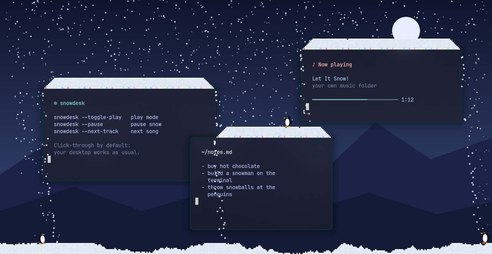
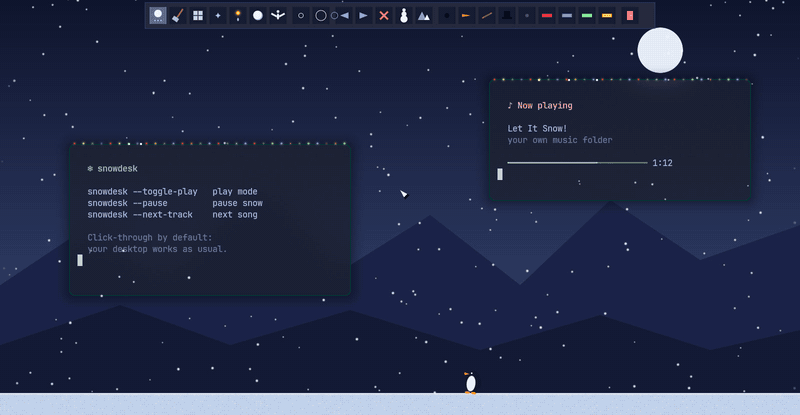
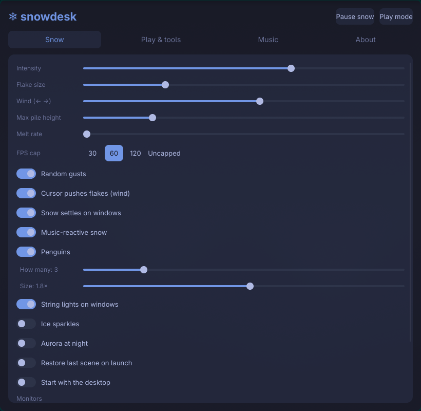

# snowdesk ❄

Snow falls over your real desktop. Poke it with the cursor, pile it up, build
snowmen, throw snowballs, and play your own music while it snows.

Written in Rust. The control panel uses [Slint](https://slint.dev) (Tokyo Night
theme); the overlay is wgpu on a layer-shell surface (Wayland) or transparent
always-on-top windows (X11, Windows).



**Play mode:** roll snowballs, lift them onto each other, decorate the snowman,
then poke, carry and snowball the penguin.



<details>
<summary>Control panel</summary>



</details>

## Download

Grab the latest build from the
[Releases page](https://github.com/legendarylolo318-cloud/snowdesk/releases):

- **Linux**: `snowdesk-vX.Y.Z-x86_64.AppImage`. Run `chmod +x` on it, then
  start it.
- **Windows 10/11**: `snowdesk-vX.Y.Z-windows-x86_64.exe`. No installer and no
  runtime DLLs needed.

Each release includes `SHA256SUMS.txt`. Check a download with
`sha256sum -c SHA256SUMS.txt --ignore-missing`.

## Features

- Transparent, **click-through**, always-on-top overlay on **every monitor**,
  with hotplug and per-monitor scaling. Passive by default: using your desktop
  is unaffected.
- Falling flakes with depth layers (parallax), sway, drift, wind and spin, plus
  random gusts. The **cursor pushes flakes like wind**.
- Settled snow is a cellular grid (snow / packed snow / ice) that slumps at its
  angle of repose.
- Snow settles on the screen bottom **and on the visible top edges of real
  windows**. Move a window gently and its snow rides along; **shake it** and
  the snow flies off. It also falls off when a window closes or minimizes.
  Snow never settles on the overlay or on snowdesk's own panel.
- **Icicles** slowly grow under snowy window edges, drip, and break off when
  the window is shaken or closed.
- Snow also settles on **bars and docks** (Hyprland layer surfaces such as
  waybar or a dock) and on the **Windows taskbar**.
- **Seasons**: winter snow, autumn leaves, spring cherry blossoms, or rain
  that collects in puddles and dries up, or **Auto** to follow the calendar.
- **Weather moods**: calm spells, steady snow, windy stretches and the
  occasional short storm, with a forecast in the panel.
- **Frost** (optional) creeps in from the screen corners while you are away;
  wipe it off, or write in it, with the mouse.
- **Play mode** tools: brush, shovel, pack, freeze, melt (dripping water that
  refreezes), snowballs (roll to grow, rigid bodies, stackable), snowmen with a
  decoration palette (eyes, nose, arms, hat, scarves, buttons), quick-stamp
  snowman, **packed-snow bricks** for forts, **igloos** penguins can walk
  into, generated mountain range, right-click flick to throw, snow angels,
  footprints where the pointer skims the snow,
  undo/redo (30 steps), clear, save/load scene, optional restore on launch.
- **Penguins**: up to 12 per monitor, sized 0.5×–3×. They waddle, leave
  footprints, sled down slopes, **skate and twirl on ice**, and **walk from
  one monitor to the next**. In play mode, click one to make it hop away, drag
  to carry it, flick to throw it. Hit one with a snowball and it falls over,
  then it and its friends **start a snowball fight**, aiming at your pointer.
  At night (9 pm-7 am) they **go home to their igloos** (warm light in the
  door) and come out in the morning; in the day they **fish** at holes you
  cut into the ice, queueing up when it gets busy. They hop onto parked
  sleds for a ride.
- **Snowmen have faces**: their eyes follow your pointer, they blink, they
  smile, and frown for a while when you hit them with a snowball.
- **Builder challenge**: tallest snowman and longest throw records (in
  snow metres), with a burst of stars when you beat one.
- **Share**: export a picture of your scene (just the snow, never your
  desktop) or a scene file a friend can import, to `Pictures/snowdesk`.
- Festive toggles: string lights on window edges, ice sparkles and a
  night-time aurora.
- **Music player** (rodio + symphonia) for mp3, ogg, flac, wav and m4a/aac,
  with tags and cover art. The folder is watched live; shuffle, repeat, volume
  and seek are included. Unreadable files are skipped, and playback moves to a
  new output device if the current one disappears.
- **Music-reactive snow**: bass hits (a small FFT on the audio thread) drive
  gusts and bursts of flakes. Optionally it reacts to **any music on the PC**
  (Spotify, a browser, games): on Linux from the speakers' monitor source
  (PulseAudio, or PipeWire with pipewire-pulse), on Windows via WASAPI
  loopback. The audio is only analysed in memory, never recorded.
- **Auto-pause**: no rendering on monitors with a focused fullscreen app or
  game. With every monitor covered, nothing is simulated or rendered.
- Tray icon, single-instance IPC, TOML config with **hot reload**, and an
  autostart toggle.
- Safety: if the overlay crashes or the GPU resets, the overlay is rebuilt. If
  it ever stops responding while it takes input (play mode), the process exits
  so your screen is never blocked.

## Controls

| Where | What |
| --- | --- |
| Tray menu / panel button / `snowdesk --toggle-play` | toggle **play mode** |
| Play mode, left button | use the selected tool (tool bar at the top of each screen) |
| Play mode, snowball tool | press and drag along the snow to roll a ball; it grows as it picks up snow |
| Play mode, while rolling | move the pointer up to lift the ball, release over a bigger ball to stack it |
| Play mode, click an existing snowball | pick it up and carry it; let go to drop it (it stacks onto a bigger ball), flick to throw it. With the snowball tool, keep rolling it bigger |
| Play mode, click a penguin | it hops and runs away |
| Play mode, drag a penguin | carry it; let go to drop it, or flick to throw it |
| Play mode, snowball a penguin | it falls over, then the penguins nearby throw snowballs back at the pointer |
| Play mode, brick tool | click or drag to lay packed-snow bricks; they stack in a staggered pattern |
| Tool bar igloo button | build an igloo (sized so the penguins fit through the door) |
| Play mode, sled tool | click to drop a sled; drag a sled and flick to push it down the slope |
| Play mode, shovel a gap into a sheet of ice | a fishing hole: penguins come and fish |
| Play mode, drag a decoration from the tool bar onto a ball | decorate a snowman |
| Play mode, right-button flick | throw a snowball |
| Tool bar `−` / `+` | brush radius |
| `Esc`, or the red door button on the tool bar | back to passive mode |
| `snowdesk --pause` | pause / resume the snow |

Stack two or three balls (smaller on top) and they become a snowman: it
wobbles, holds together and accepts decorations. A thrown snowball can still
knock it over.

## Command line and IPC

Run a second `snowdesk` with a flag to control the running instance (Unix
socket at `$XDG_RUNTIME_DIR/snowdesk.sock`; a localhost port on Windows):

```
snowdesk --toggle-play    toggle play mode
snowdesk --pause          pause / resume snow
snowdesk --clear          clear all snow and snowballs
snowdesk --next-track     skip to the next track
snowdesk --show           show the control panel
snowdesk --quit           quit
snowdesk --export-picture save a picture of the scene to Pictures/snowdesk
snowdesk --export-scene   save a shareable scene file to Pictures/snowdesk
snowdesk --hidden         start without showing the panel (tray only)
snowdesk --no-panel       overlay only: no panel, no tray
```

### Hyprland

Classic `hyprland.conf`:

```ini
exec-once = snowdesk --hidden
bind = SUPER, S, exec, snowdesk --toggle-play
bind = SUPER SHIFT, S, exec, snowdesk --pause
bind = SUPER, N, exec, snowdesk --next-track
bind = SUPER SHIFT, C, exec, snowdesk --clear
windowrule = float, class:snowdesk          # keep the panel floating
```

Lua config (`hyprland.lua`):

```lua
hl.on("hyprland.start", function()
    hl.exec_cmd("snowdesk --hidden")
end)
hl.bind("SUPER + S", hl.dsp.exec_cmd("snowdesk --toggle-play"), { description = "snowdesk play mode" })
hl.bind("SUPER + SHIFT + S", hl.dsp.exec_cmd("snowdesk --pause"), { description = "snowdesk pause" })
hl.bind("SUPER + N", hl.dsp.exec_cmd("snowdesk --next-track"), { description = "snowdesk next track" })
hl.window_rule({ name = "snowdesk", match = { class = "snowdesk" }, float = true })
```

If you run the AppImage, use its full path instead of `snowdesk`.

## Music

No music is bundled. Put your own files in any of these folders (subfolders
are scanned too):

| | Folder |
| --- | --- |
| Linux | `$XDG_DATA_HOME/snowdesk/music` (default `~/.local/share/snowdesk/music`) |
| Windows | `%APPDATA%\snowdesk\music` |
| Both | a `music/` folder next to the executable, or next to the `.AppImage` file |

On Linux, sound goes to PulseAudio or PipeWire (through pipewire-pulse) when
one is running, otherwise to ALSA. On Windows it uses WASAPI.

The first folder is created on first run. The Music tab has an "Open music
folder" button. New, removed and renamed files show up automatically.

## Configuration

- Linux: `~/.config/snowdesk/config.toml` (or under `$XDG_CONFIG_HOME`)
- Windows: `%APPDATA%\snowdesk\config\config.toml`

Settings changed in the panel apply live and are saved automatically. Edits to
`config.toml` in a text editor are picked up while snowdesk runs (hot reload).
A file with errors is reported and ignored. Saved scenes go to `scene.bin` in
the same folder.

## Platform support & known limitations

| | Overlay | Window ledges | Cursor wind | Fullscreen auto-pause |
| --- | --- | --- | --- | --- |
| Hyprland | layer-shell | yes (IPC, z-order aware) | yes (IPC) | yes, per monitor |
| other wlroots / KDE Wayland | layer-shell | **no** | **no** | **no** |
| X11 | override-redirect windows | yes (EWMH stacking) | yes | yes (EWMH) |
| Windows 10/11 | DirectComposition windows | yes (DWM bounds) | yes | yes (`SHQueryUserNotificationState`) |

- **Tested** on Arch Linux + Hyprland 0.57 with two monitors (layer-shell and,
  through XWayland, the X11 backend) and on Windows. Please report problems.
- Penguins and snowballs cross between monitors that touch side by side in
  the desktop layout (not above/below).
- GNOME Wayland has no layer-shell. There, snowdesk runs the panel and overlay
  through XWayland, which only sees X11 windows.
- Non-Hyprland Wayland compositors expose no window or cursor positions to
  clients, so snow falls only to the screen bottom and cursor wind is off.
- X11: override-redirect windows cannot take keyboard focus, so in play mode
  `Esc` is grabbed on the root window. The red door button, tray and
  `snowdesk --toggle-play` also work.
- Under XWayland on Hyprland, override-redirect windows on a second monitor
  are placed at the wrong position by the compositor. Hyprland uses the
  layer-shell backend by default, so this only affects forced X11 runs.
- Fractional scaling on Wayland renders at the next integer scale (e.g. 2× for
  1.5×), which is sharp but uses more GPU memory on those monitors.
- The Windows IPC uses a localhost TCP port (stored in the config dir) instead
  of a named pipe.

## Building

Arch Linux:

```
sudo pacman -S rust pkgconf wayland libxkbcommon alsa-lib libx11 fontconfig vulkan-icd-loader
cargo build --release
```

Debian/Ubuntu: `sudo apt install libwayland-dev libxkbcommon-dev libasound2-dev libx11-dev libfontconfig1-dev pkg-config`

Windows: install [rustup](https://rustup.rs) with the MSVC toolchain, then
`cargo build --release` (produces `target\release\snowdesk.exe`).

Checks: `cargo fmt --check && cargo clippy --all-targets -- -D warnings && cargo test`.

Environment knobs: `RUST_LOG=snowdesk=debug` for logs,
`SLINT_RENDERER=femtovg` to draw the panel on the GPU instead of the default
software renderer.

CI (`.github/workflows/ci.yml`) runs fmt, clippy and tests on Linux and
Windows on every push. `release.yml` builds the AppImage and the Windows `.exe`
from a clean checkout when a `v*` tag is pushed, then publishes a GitHub
release with SHA256 checksums.

## License

snowdesk is released under the [MIT License](LICENSE). The icons are original
to this project.

Third-party crates keep their own licenses. Notably, the
[Slint](https://slint.dev) UI toolkit is used under the Slint Royalty-free
Desktop License 2.0 (its AboutSlint widget is shown in the About tab), and the
audio decoders (Symphonia) are MPL-2.0.

[](https://slint.dev)
